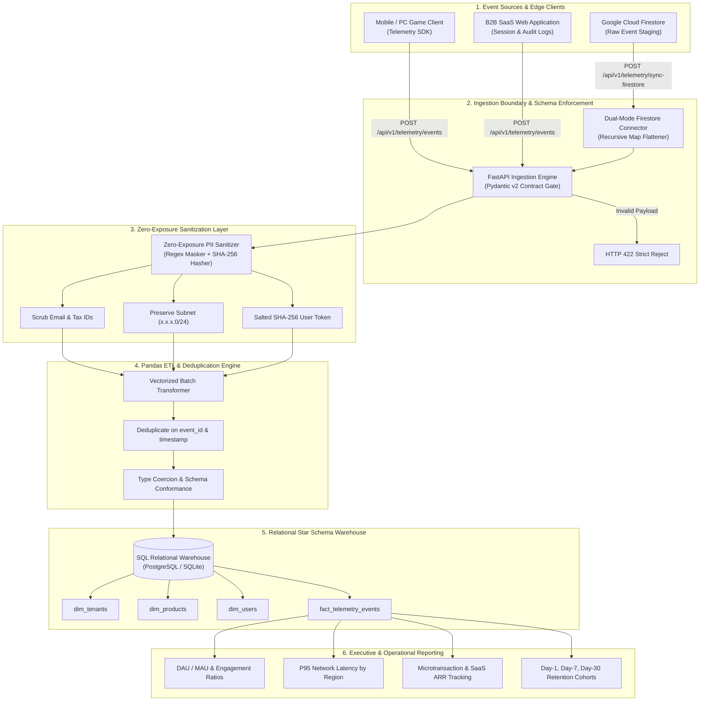
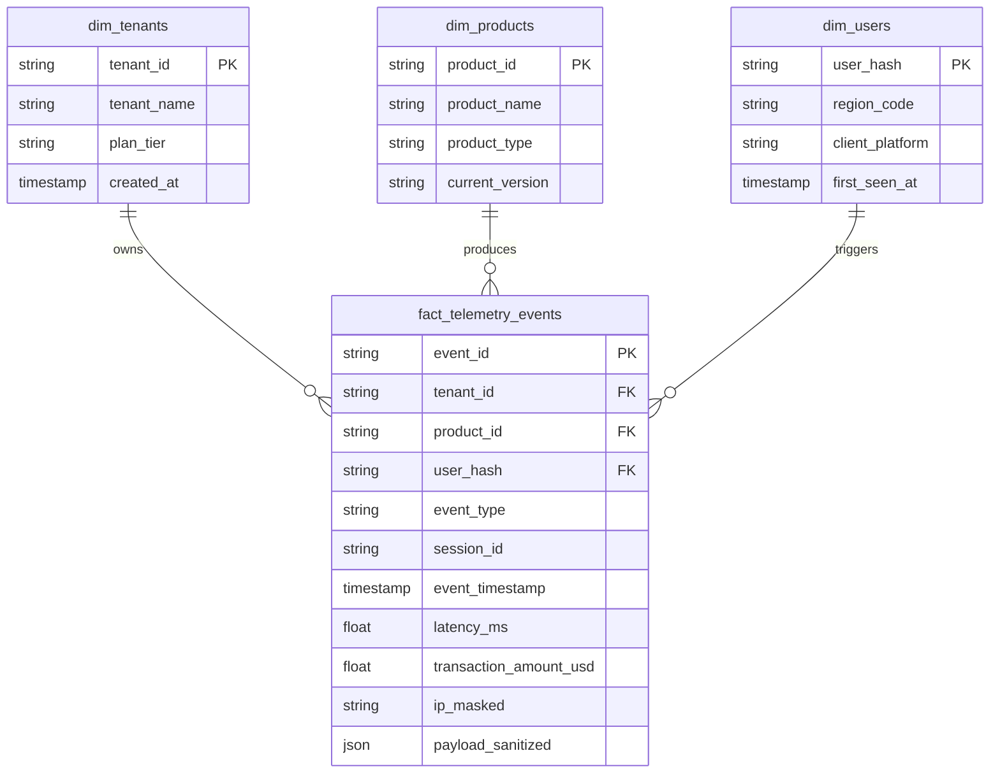

# 🎮 Game & SaaS Telemetry ETL Engine

[](https://www.python.org/)
[](https://fastapi.tiangolo.com/)
[](sql/01_schema_ddl.sql)
[](src/sanitizer.py)
[](docker-compose.yml)
[](tests/)
[](https://github.com/astral-sh/ruff)
[](LICENSE)

> High-throughput data ingestion pipeline, **Zero-Exposure PII sanitizer**, and **analytical Star Schema warehouse** for hybrid Gaming and B2B SaaS telemetry.

---

## 🎯 Executive Overview

Hybrid gaming ecosystems and multi-tenant SaaS platforms emit thousands of continuous telemetry events per second across game clients (Unity, Unreal, Mobile), web dashboards, and backend services.

Uncontrolled telemetry ingestion introduces severe operational risks:
1. **PII Contamination:** Accidental leakage of customer names, unmasked IP addresses, and emails into analytical datalakes violates GDPR and LGPD.
2. **Duplicate Metrics:** Network retries cause phantom user counts and corrupted revenue reporting.
3. **Analytical Lockup:** Flat JSON storage degrades queries calculating Daily Active Users (DAU), P95 round-trip latency, and retention cohorts.

This repository provides an enterprise-grade ETL API engineered with **FastAPI**, **Pandas**, **SQLAlchemy**, and a **Star Schema relational warehouse**. It enforces zero-exposure privacy protection at the ingestion perimeter, normalizes dual-source streams (REST and Cloud Firestore NoSQL), and guarantees idempotent warehouse persistence.

---

## 🏗️ Architecture Pipeline



---

## 🛡️ Zero-Exposure Privacy Engineering

To guarantee zero personal data leakage, raw telemetry payloads pass through `src/sanitizer.py` before touching disk or database:

- **Salted SHA-256 User Hashes:** Customer IDs, emails, and Brazilian CPFs are normalized and converted into deterministic surrogate keys (`usr_sha256_<64hex>`). The warehouse joins user journeys without ever persisting raw identities.
- **Subnet IP Masking:** IPv4 addresses have their final octet zeroed (`192.168.1.144` $\rightarrow$ `192.168.1.0/24`). Regional geolocation resolution remains accurate while individual tracking is prevented.
- **Regex PII Stripping:** Unstructured text fields (error messages, search queries, stack traces) are scanned and scrubbed of email patterns, formatted/unformatted tax IDs, and IP addresses.
- **Firestore Source Purge:** In Firestore pull mode, the connector supports `mark_synced_and_strip_pii`, replacing sensitive fields in the staging document with `[REDACTED_AFTER_ETL_SYNC]` immediately upon successful warehouse ingestion.

---

## 🗄️ Relational Star Schema Model



---

## 📈 Analytical Capabilities

The relational model directly answers core business questions via optimized SQL in `sql/02_analytical_queries.sql`:

1. **Engagement & Stickiness:** Calculates Daily Active Users (DAU), Monthly Active Users (MAU), and the DAU/MAU ratio across products.
2. **Quality of Service (QoS):** Computes **P95 latency** per region and client platform, isolating infrastructure degradations before they cause user churn.
3. **Monetization Analytics:** Aggregates gaming microtransactions and SaaS subscription events into daily gross merchandise value (GMV) by plan tier.
4. **Cohort Retention:** Tracks player and tenant retention at Day 1, Day 7, and Day 30 marks.

---

## 🚀 Quickstart & Execution

### Option 1: Run with Docker Compose (Recommended)
```bash
# Clone the repository
git clone https://github.com/jAk7star/game-saas-telemetry-etl-api.git
cd game-saas-telemetry-etl-api

# Launch the containerized API and PostgreSQL warehouse
docker compose up --build -d

# Verify API health
curl http://localhost:8000/health
```
Access interactive OpenAPI documentation at **`http://localhost:8000/docs`**.

### Option 2: Local Python Setup
```bash
# 1. Create and activate virtual environment
python -m venv .venv
source .venv/bin/activate  # Windows: .venv\Scripts\Activate.ps1

# 2. Install dependencies
pip install -r requirements.txt
pip install pytest ruff

# 3. Run the automated test suite
pytest -v

# 4. Generate 2,000 synthetic events and run batch ETL
python scripts/generate_mock_events.py --count 2000
python -m uvicorn src.main:app --reload --port 8000
```

---

## 🧪 Automated Testing Suite

The repository contains end-to-end integration and unit tests in `tests/`:
- **`tests/test_sanitizer.py`**: Verifies deterministic SHA-256 user hashing, subnet masking, and multi-pattern PII scrubbing.
- **`tests/test_api_etl.py`**: Validates REST ingestion contracts, HTTP 422 validation guards, Firestore dual-mode sync, idempotency against duplicate event IDs, and 2,000-event batch SQL execution.

```bash
pytest -v
```

---

## 👨‍💻 Author

**Jaques Gabriel Amaral Nunes**  
Data & AI Engineer  
- GitHub: [@jAk7star](https://github.com/jAk7star)  
- Email: [jaquesgabrielamaral@gmail.com](mailto:jaquesgabrielamaral@gmail.com)
