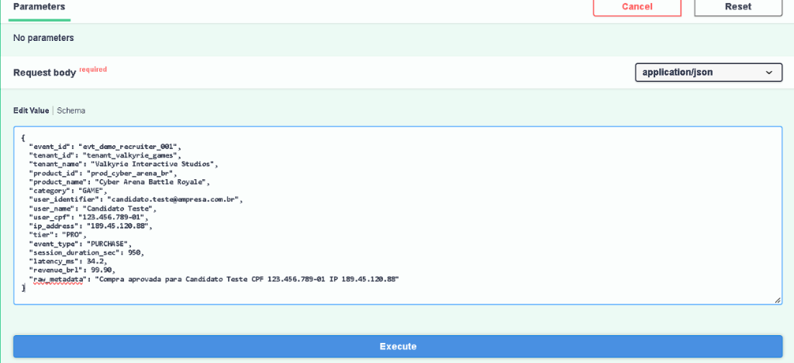
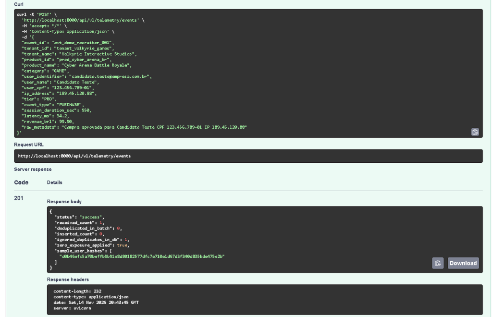
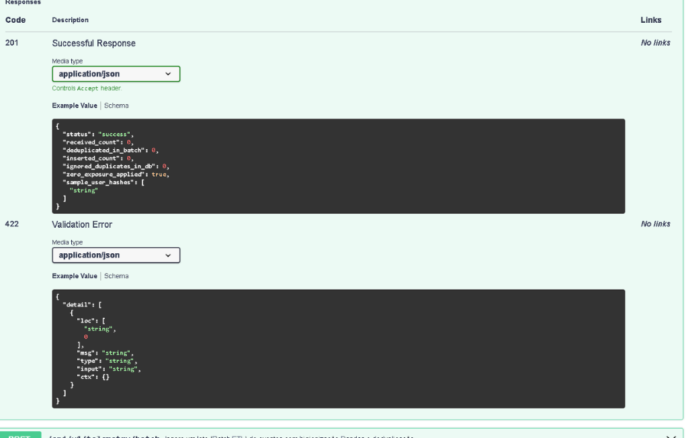

# 🎮 Game & SaaS Telemetry ETL API (`FastAPI` + `Python` + `SQL` + `Docker`)


## 🎯 O Problema de Negócio
Ecossistemas híbridos que operam **jogos eletrônicos** e **plataformas SaaS Enterprise** geram milhares de eventos simultâneos de sessão, latência e microtransações. Ingerir esses dados sem contrato rígido gera duplicidade de registros, exposição de dados pessoais (LGPD) e métricas distorcidas nos dashboards estratégicos.

## 🏗️ Arquitetura da Solução
Pipeline de dados orientado a eventos e lotes estruturado em camadas desacopladas:

```text
[Eventos Games & SaaS (JSON)]
             │
             ▼
┌──────────────────────────────────────────────────────────┐
│ 1. INGESTION LAYER (FastAPI + Pydantic v2)               │
│ Valida contratos de entrada e rejeita erros (HTTP 422)   │
└────────────────────────────┬─────────────────────────────┘
                             ▼
┌──────────────────────────────────────────────────────────┐
│ 2. ZERO-EXPOSURE & ETL (Python + Pandas + Regex)         │
│ Anonimiza PII (e-mail/IP), trata nulos e deduplica IDs   │
└────────────────────────────┬─────────────────────────────┘
                             ▼
┌──────────────────────────────────────────────────────────┐
│ 3. RELATIONAL WAREHOUSE (SQL Star Schema)                │
│ Persistência idempotente + Queries Analíticas (DAU/P95)  │
└──────────────────────────────────────────────────────────┘
```

## 📂 Estrutura do Repositório

```text
game-saas-telemetry-etl-api/
├── docker-compose.yml             # Orquestração da API FastAPI + Banco Relacional (PostgreSQL/SQLite)
├── Dockerfile                     # Imagem enxuta python:3.11-slim
├── requirements.txt               # fastapi, uvicorn, pydantic, pandas, sqlalchemy, pytest
├── .env.example                   # Template de variáveis de ambiente (Zero-Exposure)
├── .gitignore                     # Bloqueio de .env, *.db, __pycache__ e logs locais
├── README.md                      # Documentação executiva com diagrama e Learning Agility
├── docs/assets/                   # Evidências visuais de execução (Swagger UI & Idempotência)
├── sql/
│   ├── 01_schema_ddl.sql          # Criação das tabelas (dim_tenants, dim_products, dim_users, fact_telemetry_events)
│   └── 02_analytical_queries.sql  # Queries SQL puras: DAU/MAU, Retenção, Latência P95 e Receita SaaS/Game
├── src/
│   ├── __init__.py
│   ├── main.py                    # Entrypoint FastAPI + Swagger/OpenAPI (/docs)
│   ├── schemas.py                 # Contratos Pydantic v2 (validação rigorosa de entrada e HTTP 422)
│   ├── sanitizer.py               # Camada Zero-Exposure (Regex + hash SHA-256 para PII)
│   ├── etl_pipeline.py            # Transformação em lote com Pandas (deduplicação e tipagem)
│   └── database.py                # Conexão SQLAlchemy e execução parametrizada
├── scripts/
│   └── generate_mock_events.py    # Gerador de 2.000 eventos sintéticos (Games & SaaS) com anomalias
└── tests/
    ├── test_sanitizer.py          # Testes unitários da anonimização Zero-Exposure
    └── test_api_etl.py            # Testes de integração dos endpoints e idempotência SQL
```

## 📸 Evidências de Execução (Swagger UI, Zero-Exposure & Idempotência)

### 1. Payload de Entrada com Dados Sensíveis (PII) no `POST /api/v1/telemetry/events`


### 2. Resposta Idempotente (`201 Created`) + Hash Determinístico SHA-256 (`Zero-Exposure`)
Ao reenviar o mesmo `event_id` (`evt_demo_recruiter_001`), a API protege o banco relacional (`"inserted_count": 0`, `"ignored_duplicates_in_db": 1`) e retorna apenas o hash anonimizado (`d0b46efc5a70beffb9b91e8d80182577dfc7e710e1d67d3f340d835bde475e2b`):


### 3. Contratos Tipados Pydantic v2 (`201` & `422 Validation Error`)


## 🚀 Como Executar (Quick Start)

```bash
# 1. Subir a infraestrutura conteinerizada (API + Banco SQL)
docker-compose up --build -d

# 2. Acessar a documentação interativa Swagger/OpenAPI
# http://localhost:8000/docs

# 3. Popular com 2.000 eventos sintéticos (Games & SaaS)
python scripts/generate_mock_events.py

# 4. Rodar a suíte de testes automatizados
pytest -v
```

## 📈 Evolução Técnica (Learning Agility)
> "Já dominava pipelines ETL em memória com Python/Pandas e modelagem teórica de dados, mas precisava comprovar ingestão via API RESTful conectada diretamente a um banco relacional SQL auditável ➔ Estudei contratos tipados com FastAPI/Pydantic, modelagem Star Schema (DDL/DML) e consultas analíticas com CTEs e Window Functions ➔ Minha primeira versão gravava eventos diretamente no banco sem validação de unicidade, gerando duplicatas em retentativas de rede ➔ Refatorei a camada de persistência implementando chaves primárias determinísticas (`event_id`), sanitização Zero-Exposure na entrada e conteinerização com Docker Compose, entregando uma API resiliente e pronta para consumo em BI."
